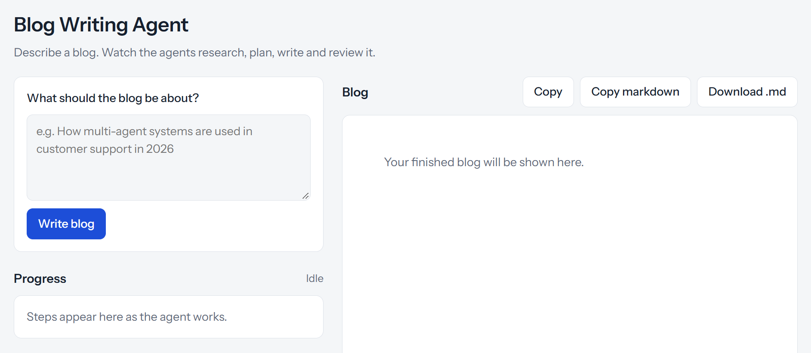
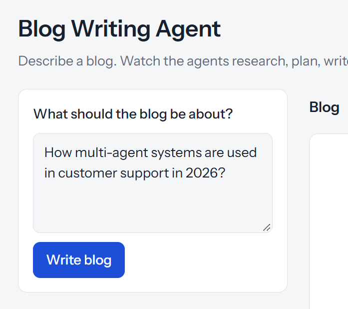
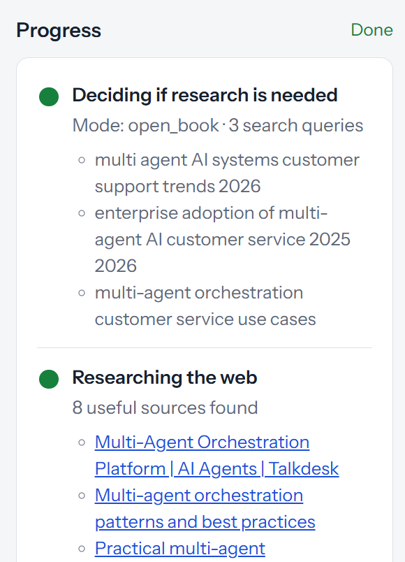
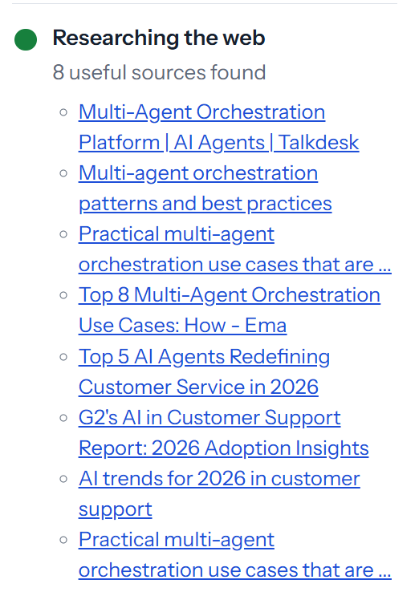
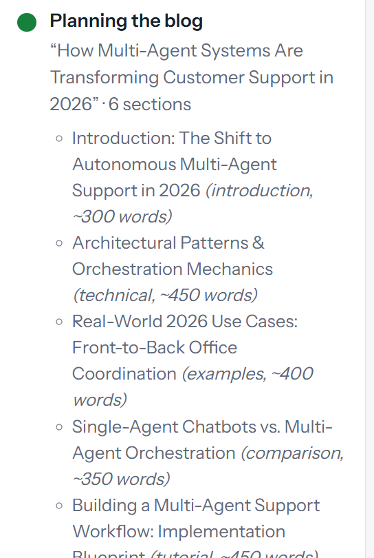
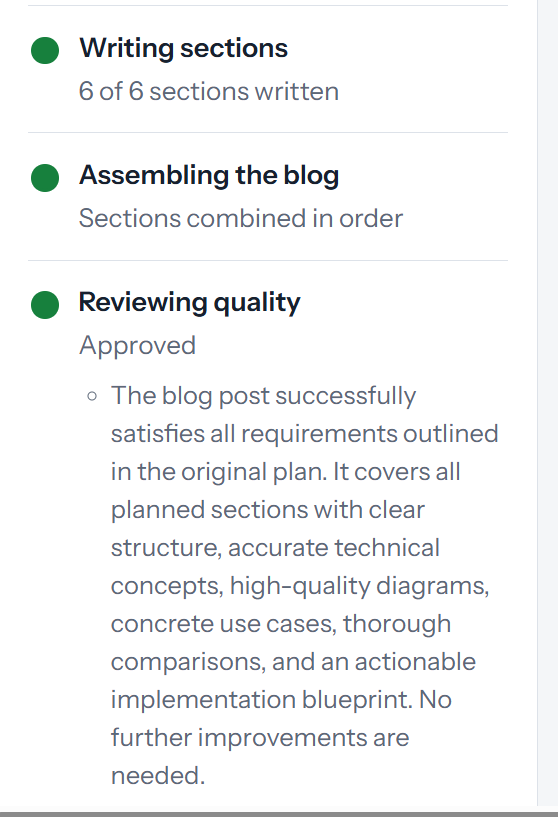
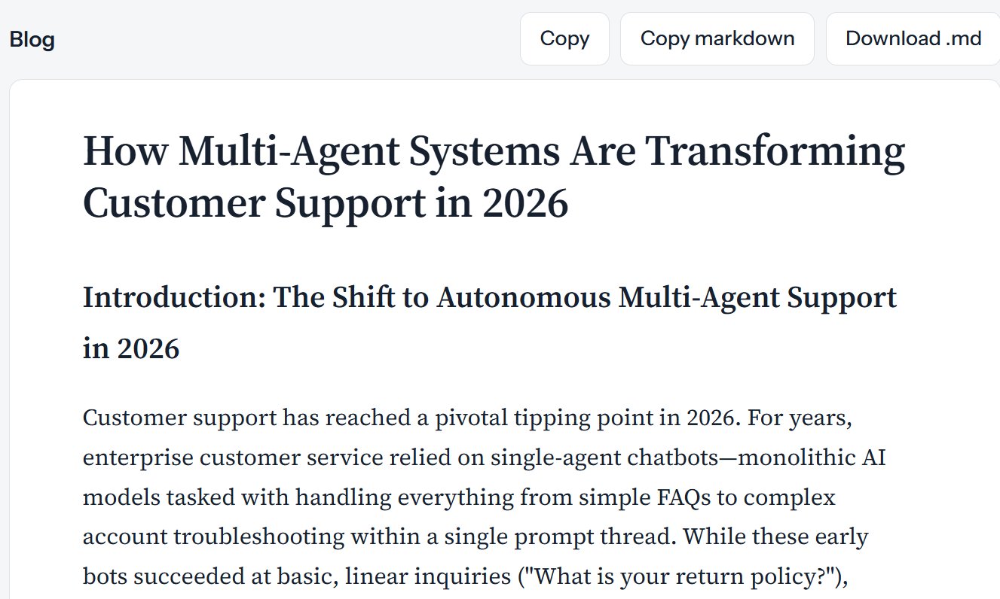
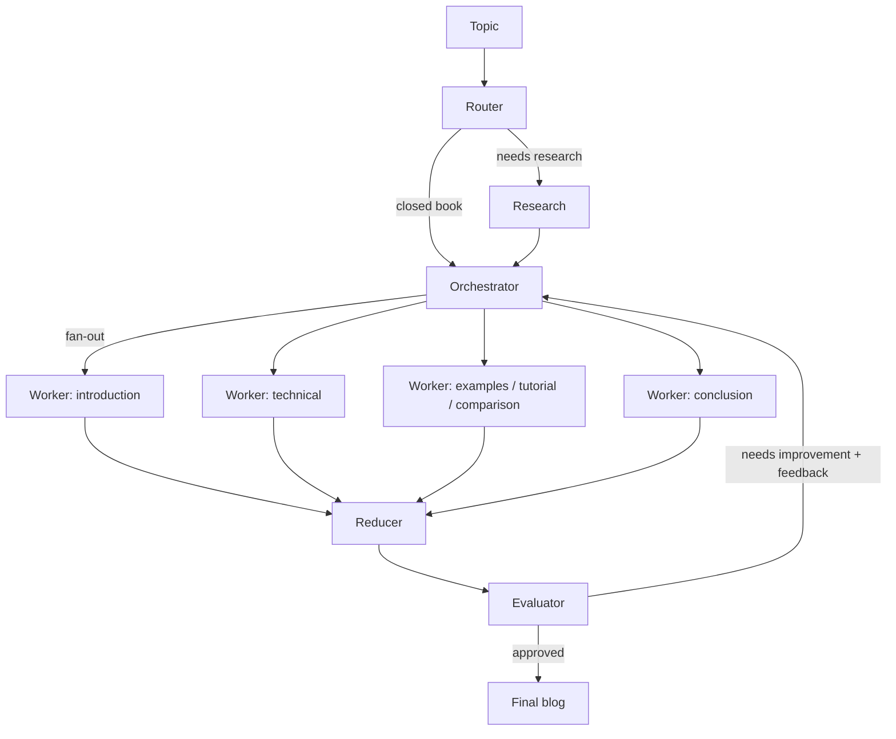

# Blog Writing Agent

A multi-agent system that writes a complete blog from a single topic. It decides whether web research is needed, plans the blog, writes every section in parallel with specialised writers, then reviews the result and sends it back for improvement if it isn't good enough. A web interface shows each step live while the agent works.

Built with **LangGraph**, **LangChain**, **Gemini**, **FastMCP** and **FastAPI**.

## Glimpse of the Agent








## How it works



| Node | What it does |
|---|---|
| **Router** | Reads the topic and picks a mode: `closed_book`, `hybrid` or `open_book`. Generates search queries when research is needed. |
| **Research** | Calls a web search tool (served over MCP), then filters the raw results into structured evidence. |
| **Orchestrator** | Creates the blog title and a plan: a list of sections, each with a goal, brief, word target and worker type. |
| **Workers** | One worker per section, run in parallel using LangGraph's `Send` API. Each worker type has its own LLM. |
| **Reducer** | Sorts the sections by id and joins them into one markdown blog. |
| **Evaluator** | Scores the blog for relevance, completeness, accuracy, structure and quality. If it needs work, its feedback goes back to the orchestrator and the loop repeats (up to a set maximum). |

## Features

- Conditional routing: research only when the topic needs it
- Parallel section writing with specialised workers
- Self-review loop with evaluator feedback
- Web search through a local MCP server
- Live progress in the browser (server-sent events)
- Blog shown as formatted text, with **Copy**, **Copy markdown** and **Download .md** buttons

## Project structure

```
BLOG_WRITING_AGENT/
|-- assets/
|   |-- final.png
|   |-- home_page.png
|   |-- input_window.png
|   |-- progress_panel_1.png
|   |-- progress_panel_2.png
|   |-- progress_panel_3.png
|   |-- progress_panel_4.png
|-- backend/
|   |-- agent.py      # Langgraph agent 
|   |-- mcp_server.py # FastMCP server
|   |-- main.py       # FastAPI server
|-- frontend/
|   |-- index.html
|   |-- style.css
|   |-- script.js
|-- .env              # API keys
|-- requirements.txt
|-- README.md
|-- .gitignore
```

## Getting started

**Python version** : Python 3.13.7

### 1. Clone and install

```bash
git clone https://github.com/Sani8Rk9git/BLOG_WRITING_AGENT.git
cd BLOG_WRITING_AGENT
python -m venv venv
venv\Scripts\activate          # Windows
# source venv/bin/activate     # macOS / Linux
pip install -r requirements.txt
```

### 2. Add your API keys

Create a `.env` file in the project root. Each agent reads its own key, so you can spread the load across keys or use the same key for all of them:

```
PLAN         = your_gemini_key
RESEARCH     = your_gemini_key
ROUTER       = your_gemini_key
EVALUATOR    = your_gemini_key
INTRODUCTION = your_gemini_key
TECHNICAL    = your_gemini_key
EXAMPLES     = your_gemini_key
TUTORIAL     = your_gemini_key
COMPARISON   = your_gemini_key
CONCLUSION   = your_gemini_key
```

Get keys from [Google AI Studio](https://aistudio.google.com/). Never commit `.env`.

### 3. Run

From the project root:

```bash
uvicorn backend.main:app
```

Open http://127.0.0.1:8000, type a topic, and click **Write blog**. A full run takes a few minutes because every section is written by an LLM and the blog may be revised.

## Tech stack

- **LangGraph**: stateful graph with conditional edges, fan-out (`Send`) and a feedback loop
- **LangChain**: prompts, Pydantic output parsers, Gemini integration
- **Gemini** (`langchain-google-genai`): the LLMs behind every node
- **FastMCP** + `langchain-mcp-adapters`: the web search tool, connected to the agent over stdio
- **FastAPI**: API and static file server, with streaming via server-sent events
- **Vanilla HTML/CSS/JS**: the frontend(pure HTML, CSS, JS), with `marked` and `DOMPurify` for rendering markdown safely 

## My learning journey

This project is the result of learning in stages:

1. **LangChain**: learned the basics (prompts, models, output parsers) and built small, linear workflows.
2. **LangGraph**: moved to graphs, with state, conditional routing, parallel nodes and loops.
3. **This agent**: my first complex workflow, combining routing, tool use over MCP, orchestrator-worker planning, and an evaluator feedback loop, then wrapped in a web interface.

## Notes and limitations

- Each evaluator round re-runs every worker, so more rounds cost more API calls and time.
- Output quality depends on the search results and the model; always read the blog before publishing it.
- Intended for local use. If you deploy it publicly, add rate limiting so others can't use up your API quota.

## Possible next steps

- Show each section on screen as soon as it is written
- Save past blogs and reopen them
- Let the user choose tone and length

## Author

**SANIDHYA SHARMA**

[LinkedIn](https://www.linkedin.com/in/sanidhya-sharma-2354303a8)